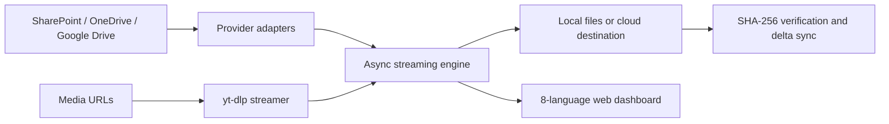

## 🌐 8 Languages Supported · RTL / LTR

🇸🇦 العربية • 🇺🇸 English • 🇪🇸 Español • 🇫🇷 Français • 🇩🇪 Deutsch • 🇨🇳 中文 • 🇷🇺 Русский • 🇧🇷 Português

## Feature Matrix / مقارنة المزايا

| Capability | OSDD | Traditional browser download | Sync clients |
|---|---|---|---|
| Large folders without ZIP packaging | Direct file-by-file streaming | Often ZIP-based with service limits | Usually syncs locally first |
| Cloud-to-cloud transfer | Direct stream bridge across supported providers | Not supported | Provider-specific |
| Delta sync with SHA-256 audit | Yes | No | Varies; often no hash audit |
| Interrupted transfer recovery | HTTP range resume | Limited | Usually supported |
| Media sources and playlists | Universal media streamer | One page at a time | Not supported |
| Localized dashboard | 8 languages, RTL/LTR | Browser UI only | Client-dependent |

## Architecture Workflow / مخطط سير العمل



---

# OmniSync-Downloader (OSDD)

<div align="center">

**Resilient Multi-Source File Streamer & Sync Engine**  
*أداة التحميل المباشر والمزامنة الذكية للملفات والمجلدات الضخمة*

[](https://github.com/esgindy/OmniSync-Downloader-OSDD/releases)
[](https://www.python.org/)
[](LICENSE)
[]()
[]()

[English](#-english) • [العربية](#-باللغة-العربية)

</div>

---

## 🇬🇧 English

### 🌟 Overview

**OmniSync-Downloader (OSDD)** is a high-performance, open-source tool and web dashboard designed to eliminate the common headaches of downloading and synchronizing large directories from cloud and local/network storage.

- In **v1.0**, OSDD solved Microsoft SharePoint and OneDrive folder downloads by pulling files **directly file-by-file**, bypassing server-side zip compression that leads to corrupted archives, download timeouts, and the restrictive 250 GB / 10,000 file caps.
- In **v2.0**, OSDD introduced a native **Drive-to-Drive / Disk-to-Disk Sync & Deep Audit Engine** with chunked streaming SHA-256 verification (< 5MB RAM even for 100GB+ files), live dashboard indicators (speed, downloaded vs. remaining volume, remaining files), 1-click silent background execution, and automatic process termination when the browser closes.
- In **v3.0**, OSDD introduced **Google Drive Direct Streaming & Cloud-to-Cloud Bridge**: file-by-file direct download of Google Drive shared links (bypassing the 2GB zip limit and download timeouts), direct stream piping between cloud providers (e.g. SharePoint to Google Drive / OneDrive), top-positioned live dashboard, and a built-in 8-language localization engine.
- In **v4.0**, OSDD introduces the **Universal Media & Social Streamer & 1-Click Auto-Installer**: direct video, audio, and playlist streaming from YouTube (including Shorts), TikTok, Instagram (Reels & Posts), Facebook, X (Twitter), Reddit, Vimeo, SoundCloud and more with custom quality selection (4K/1080p/720p/480p) or instant MP3 audio extraction, unified real-time dashboard telemetry, and a zero-config 1-Click **`install.bat`** script that automatically downloads Python 3 and installs all dependencies and browser drivers silently with an automated completion dialog in English.

---

### ✨ Features (v4.0)

#### 🎬 Universal Media & Social Downloader (New in v4.0)
- **Universal Multi-Platform Support:** Download high-resolution media from YouTube, Shorts, Playlists, TikTok, Instagram, Reels, Facebook, X (Twitter), Reddit, Vimeo, SoundCloud, and Pinterest.
- **Smart Quality & Format Presets:** Choose from Best MP4, Full HD (1080p), HD (720p), SD (480p), or direct audio extraction to MP3 / M4A.
- **Playlist Streaming:** Automatically detect, enumerate, and download entire playlists file-by-file.
- **Integrated Live Dashboard Telemetry:** Media downloads pipe live speed, progress, remaining bytes, and ETA straight into the top telemetry dashboard.

#### ⚙️ 1-Click Automatic Setup & Dependency Installer (`install.bat`) (New in v4.0)
- **Zero-Manual-Setup:** Double-click **`install.bat`** to get everything ready automatically.
- **Automatic Python 3 Detection & Silent Download:** If Python 3 is missing, the script automatically downloads the official 64-bit installer from python.org, installs it silently, and configures PATH.
- **Full Library & Driver Installation:** Automatically upgrades pip, installs all packages from `requirements.txt`, and configures Playwright Chromium drivers.
- **Ready Notification in English:** Shows clear English console output and an instant Windows GUI dialog notifying that the application is ready and directing the user to click `start.bat`.

#### 🌐 Google Drive Direct Streaming & Cloud-to-Cloud Bridge (v3.0)
- **Google Drive File-by-File Streaming:** Download large Google Drive shared folders and files directly without waiting for Google to zip them (no 2GB zip splitting, no archive corruption).
- **Virus Scan Warning Bypass:** Automatic token handling for large files that trigger Google's antivirus warning page.
- **Direct Cloud-to-Cloud Bridge:** Stream-pipe files directly between cloud sources (SharePoint, OneDrive, Google Drive) without needing full intermediate disk caching.
- **Top Live Dashboard:** Live download speedometer, progress KPIs, and remaining counters pinned to the top of the interface.
- **Multi-Language Switcher (8 Languages):** Instant UI localization supporting Arabic (العربية), English, Spanish (Español), French (Français), German (Deutsch), Chinese (中文), Russian (Русский), and Portuguese (Português).

#### 💽 Drive-to-Drive / Disk-to-Disk Sync & Deep Audit (v2.0)
- **Directory Tree Comparison:** Compare folders across different drives, external USB HDDs, or NAS network shares.
- **Delta Sync (Copy-based, Non-destructive):** Detects and copies **only new and modified files**; original source files are untouched.
- **Streaming SHA-256 Deep Audit:** 1MB chunked cryptographic hash verification with **< 5MB RAM consumption** even on massive 100GB+ files.
- **Safe Atomic Copying:** Uses `.sync_part` and atomic rename with original timestamp preservation (`shutil.copystat`).
- **Live Transfer Telemetry:** Real-time speedometer (MB/s), copied vs. remaining bytes, remaining files, current active file, and full pause/resume/cancel controls.

#### 📊 Live Download Dashboard KPIs (v2.0)
- **⚡ Live Transfer Speedometer:** Instantaneous download and sync transfer speed in KB/s and MB/s.
- **💾 Explicit Remaining Bytes:** Shows downloaded volume alongside remaining volume clearly (e.g., `14.2 GB / 50.0 GB (Remaining: 35.8 GB)`).
- **📄 Remaining Files Counter:** Shows completed files vs. remaining files (e.g., `120 / 500 (Remaining: 380)`).
- **⏱️ Dynamic ETA & Progress:** Accurate estimated completion time based on live transfer speed.

#### 🚀 1-Click Silent Background Launch & Smart Auto-Close (v2.0)
- **`start.bat` & `start.vbs`:** 1-Click launch directly into the background without popping any black CMD console window.
- **Automatic Browser Launch:** Directly opens `http://127.0.0.1:8765` in your default browser.
- **Intelligent Auto-Shutdown:** Automatically stops the Python background server and cleans RAM when the browser window/tab is closed (Heartbeat + `pagehide` beacon).
- **`stop.bat` & UI Shutdown Button:** Manual 1-click stop script and an in-app shutdown button in the topbar.

#### ☁️ SharePoint & OneDrive Direct File-by-File Streaming (v1.0 Core)
- **Direct File-by-File Streaming:** Downloads entire folder trees file-by-file with exact folder hierarchy on disk.
- **True HTTP Range Resumption:** Interrupted connections resume byte-for-byte from partial `.part` files without restarting from zero.
- **Smart Browser Authentication:** Automated login via Edge/Chrome to capture FedAuth & session cookies, with fallback cURL / cookie import.
- **Integrity Audit & Verification:** Post-download byte-level comparison, missing file detection, and CSV / JSON export.
- **Windows Long Path & Unicode Support:** Native handling of paths exceeding 260 characters (`\\?\` prefix) and robust UTF-8 Arabic character sanitization.

---

### 🚀 Quick Start

#### 1. Clone or Download
```bash
git clone https://github.com/esgindy/OmniSync-Downloader-OSDD.git
cd OmniSync-Downloader-OSDD
```

#### 2. Automatic 1-Click Setup (New in v4.0 - Recommended)
- Double-click **`install.bat`**.
- It will automatically check Python 3 (downloading & installing it silently if missing), install all dependencies, configure browser drivers, and display a popup confirming that the app is ready to use.

#### 3. Run the Application
- **Windows (1-Click Silent Start - Recommended):** Double-click **`start.bat`** (or `start.vbs`).
  - Launches silently in the background (no black CMD window).
  - Automatically opens the web interface in your default browser.
  - Automatically terminates when you close the browser window, or via **`stop.bat`**.
- **Windows (Console Mode):** Double-click **`run.bat`** if you wish to see live server logs in CMD.
- Open your browser at: **`http://127.0.0.1:8765`**

---

## 🇸🇦 باللغة العربية

### 🌟 نظرة عامة

**OmniSync-Downloader (OSDD)** هي أداة برمجية مفتوحة المصدر عالية الأداء تم بناؤها للتغلب على مشاكل تحميل ومزامنة المجلدات والمكتبات الضخمة من السحابة ووحدات التخزين المحلية والشبكية.

- في **الإصدار v1.0**، ركز البرنامج على حل مشاكل تحميل مجلدات **Microsoft SharePoint** و **OneDrive** عبر سحب الملفات مباشرة **ملفاً بملف** دون تجميعها في ملف مضغوط (Zip)، مما يمنع تلف الملفات ويتجاوز حدود شيربوينت الصارمة (250GB أو 10,000 ملف).
- في **الإصدار v2.0**، قدم البرنامج ميزة **مزامنة وتدقيق الملفات بين هاردين أو جهازين (Drive-to-Drive Sync & Deep Audit)** بفحص الهاش المتدفق (SHA-256) للملفات العملاقة (+100GB) باستهلاك رام أقل من 5 ميجابايت، مع مؤشرات حية في الداش بورد لحجم وعدد الملفات المتبقية والسرعة اللحظية، وتشغيل صامت بالكامل وإيقاف تلقائي عند إغلاق المتصفح.
- في **الإصدار v3.0**، أضاف البرنامج دعم **التحميل المباشر من Google Drive وجسر النقل السحابي (Cloud-to-Cloud Bridge)**: تحميل ملفات ومجلدات جوجل درايف ملفاً بملف متجاوزاً قيود الضغط (حد الـ 2GB وتجزئة الملفات المضغوطة)، ونقل مباشر من سحابة إلى سحابة، مع تثبيت لوحة المتابعة الحية في أعلى الواجهة، ومبدل لغات فوري يدعم 8 لغات عالمية.
- في **الإصدار v4.0**، يقدم البرنامج **محرك التحميل الشامل للوسائط وشبكات التواصل الاجتماعي ومثبت المتطلبات التلقائي بنقرة واحدة (1-Click Auto-Installer)**: تنزيل الفيديوهات والصوتيات وقوائم التشغيل مباشرة من YouTube و TikTok و Instagram و Facebook و X و Reddit و Vimeo بأعلى جودة أو استخراج الصوت MP3، مع تكامل كامل مع لوحة المتابعة اللحظية، وملف **`install.bat`** الذي يقوم بفحص وتثبيت Python 3 تلقائياً وتحميل كافة المكتبات بدون أي تدخل يدوي مع إظهار رسالة جاهزية البرنامج بالإنجليزية.

---

### ✨ أبرز مميزات الإصدار v4.0

#### 🎬 محرك التحميل الشامل للوسائط واليوتيوب (جديد في v4.0)
- **دعم شامل للمنصات وشبكات التواصل:** تحميل مباشر من YouTube (الفيديوهات العادية، Shorts، وقوائم التشغيل Playlists)، TikTok، Instagram (Reels & Posts)، Facebook، X (Twitter)، Reddit، Vimeo، SoundCloud، و Pinterest.
- **خيارات الجودة والصيغ المتنوعة:** تحميل بأعلى جودة متوفرة (Best MP4) أو 1080p أو 720p أو 480p، أو استخراج الصوت فقط بصيغة MP3 و M4A.
- **تحميل قوائم التشغيل (Playlists):** فحص تلقائي لعدد الفيديوهات وتحميلها ملفاً بملف بهيكلية منتظمة.
- **متابعة حية عبر الداش بورد الموحدة:** ربط سرعة ونسبة وتقدم تحميل الوسائط مباشرة مع عداد السرعة ومؤشرات الداش بورد في أعلى الواجهة.

#### ⚙️ التثبيت التلقائي الذكي بنقرة واحدة (`install.bat`) (جديد في v4.0)
- **تشغيل فوري بدون إعداد يدوي:** يكفي الضغط مرتين على ملف **`install.bat`**.
- **الكشف عن Python وتثبيته تلقائياً:** في حال عدم وجود بايثون 3 على الجهاز، يقوم السكريبت بتحميل النسخة الرسمية المناسبة لويندوز وتثبيتها في الخلفية وضبط المسارات (PATH) دون أي عناء.
- **تثبيت الحزم ومحركات المتصفح:** ترقية pip وتثبيت مكتبات `requirements.txt` وتحميل مشغل Chromium لـ Playwright.
- **رسالة جاهزية باللغة الإنجليزية:** ظهور إشعار ونافذة منبثقة رسمية باللغة الإنجليزية تؤكد اكتمال التثبيت وتوجيه المستخدم لتشغيل `start.bat`.

---

### 💻 خطوات التشغيل السريع

1. قم باستنساخ أو تنزيل المستودع:
   ```bash
   git clone https://github.com/esgindy/OmniSync-Downloader-OSDD.git
   cd OmniSync-Downloader-OSDD
   ```
2. **التثبيت التلقائي بنقرة واحدة (جديد في v4.0 - مستحسن):**
   - اضغط مرتين على ملف **`install.bat`**.
   - سيقوم السكريبت بتثبيت بايثون والمكتبات والمتطلبات بالكامل، وستظهر رسالة تؤكد أن البرنامج جاهز للعمل.
3. **تشغيل البرنامج:**
   - اضغط مرتين على ملف **`start.bat`** (أو `start.vbs`) لبدء البرنامج في الخلفية وفتح المتصفح فوراً على الرابط:
     **`http://127.0.0.1:8765`**

---

## 🔒 الخصوصية والأمان / Privacy & Security

- الأداة تعمل محلياً 100%، ولا يتم إرسال أي بيانات أو جلسات أو كوكيز إلى أي خادم خارجي.

---

## 📄 الترخيص / License

هذا المشروع مرخص تحت رخصة **MIT License**.
