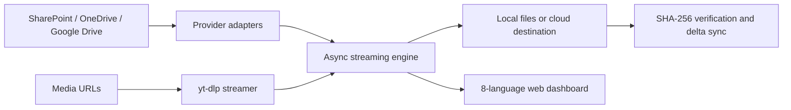
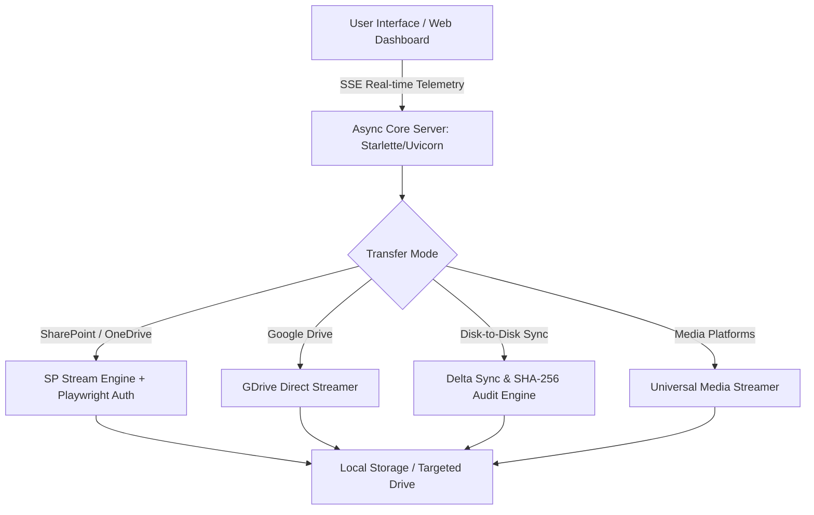

## 🌐 8 Languages Supported · RTL / LTR

🇸🇦 العربية • 🇺🇸 English • 🇪🇸 Español • 🇫🇷 Français • 🇩🇪 Deutsch • 🇨🇳 中文 • 🇷🇺 Русский • 🇧🇷 Português

## Feature Matrix / مقارنة المزايا

| Capability | OSDD | Traditional browser download | Sync clients |
|---|---|---|---|
| Large folders without ZIP packaging | Direct file-by-file streaming | Often ZIP-based with service limits | Usually syncs locally first |
| Cloud-to-cloud transfer | Direct stream bridge across supported providers | Not supported | Provider-specific |
| Delta sync with SHA-256 audit | Yes | No | Varies; often no hash audit |
| Interrupted transfer recovery | HTTP range resume | Limited | Usually supported |
| Media sources and playlists | Universal media streamer | One page at a time | Not supported |
| Localized dashboard | 8 languages, RTL/LTR | Browser UI only | Client-dependent |

## Architecture Workflow / مخطط سير العمل



---

# OmniSync-Downloader (OSDD)

<div align="center">

**Enterprise-Grade Multi-Source File Streamer & High-Speed Data Sync Engine**  
*الأداة البرمجية المتقدمة للتحميل المباشر المتدفق والمزامنة الفائقة للملفات والمكتبات الضخمة*

[](https://github.com/esgindy/OmniSync-Downloader-OSDD/releases)
[](https://www.python.org/)
[](LICENSE)
[]()
[]()
[-success.svg)]()

---

### 🌐 Built-in 8-Language UI Support / واجهة متعددة اللغات تدعم 8 لغات عالمية
**🇸🇦 العربية** &nbsp;•&nbsp; **🇺🇸 English** &nbsp;•&nbsp; **🇪🇸 Español** &nbsp;•&nbsp; **🇫🇷 Français** &nbsp;•&nbsp; **🇩🇪 Deutsch** &nbsp;•&nbsp; **🇨🇳 中文** &nbsp;•&nbsp; **🇷🇺 Русский** &nbsp;•&nbsp; **🇧🇷 Português**

*The application features an instant real-time localization switcher with native RTL (Right-to-Left) and LTR (Left-to-Right) layout adjustments.*

---

[English Guide](#-english) • [الدليل باللغة العربية](#-دليل-الاستخدام-باللغة-العربية) • [GitHub Topics & Tags](#-recommended-github-topics--hashtags)

</div>

---

## 🆕 What's New in v5.0 / الجديد في الإصدار 5.0

### 🇬🇧 English
- **Security:** a Host/Origin guard rejects any non-local `Host`/`Origin` and `Sec-Fetch-Site: cross-site` requests (blocks CSRF and DNS rebinding). Graceful shutdown: the server asks uvicorn to stop so active downloads are cancelled cleanly (10 s fallback); heartbeat timeout is 25 s.
- **Performance:** HTTP/2 (with fallback), exponential backoff honoring `Retry-After`/429, parallel `Range` chunks for large files (resume metadata in `.part.pdl`), and a bandwidth limiter via `speed_limit_kbps` (0 = unlimited) on `/api/download/start` and `/api/sync/download`.
- **Disk sync:** fast compare by size + mtime (2 s tolerance); hashing only when mtime differs or when `"deep": true`. `POST /api/disk/dryrun` `{source_dir, dest_dir, deep, delete_extra}` previews a plan without touching files; `POST /api/disk/duplicates` `{root, min_size?}` finds duplicate files.
- **UI:** 5 themes (+ auto) and a tab bar with KPI cards, workers view and a 60 s speed sparkline. (UI wiring for the features below is pending.)
- **Filters:** `filters` object on `/api/download/start` and `/api/sync/download`: `include_ext`, `exclude_ext`, `min_size`, `max_size`, `modified_after`, `modified_before`, `exclude_regex`. Try them with `POST /api/filters/test` `{filter, samples:[...]}`.
- **Job queue:** `POST /api/queue/add` `{kind: download|sync|media, params, priority}`, `GET /api/queue`, `POST /api/queue/cancel` `{id}`. Higher priority first, FIFO within.
- **Scheduler:** `POST /api/schedule` `{kind, params, every: daily|weekly|interval_minutes, time: "HH:MM", weekday?, minutes?}`, `GET /api/schedule`, `DELETE /api/schedule?id=`. Fires jobs into the queue.
- **Notifications:** Windows toast and/or Telegram on job completion. `GET/POST /api/settings/notify` `{toast, telegram_enabled, telegram_chat_id, telegram_token, clear_token}` (the token is never returned) and `POST /api/notify/test`.
- **History:** SQLite job history: `GET /api/history?limit=`, `DELETE /api/history`, `GET /api/history/export` (CSV).
- **CI:** GitHub Actions workflow (`.github/workflows/ci.yml`), `ruff.toml`, and `requirements.lock.txt`.

### 🇸🇦 العربية
- **الأمان:** حارس Host/Origin يرفض أي طلب غير محلي وطلبات `cross-site` (يمنع CSRF وDNS rebinding). إيقاف آمن (graceful) يلغي التحميل الجاري بسلاسة، ومهلة heartbeat هي 25 ثانية.
- **الأداء:** HTTP/2، وbackoff أسي مع احترام `Retry-After` وكود 429، وتحميل الملفات الكبيرة بأجزاء Range متوازية (ملف الاستئناف `.part.pdl`)، وحد للسرعة `speed_limit_kbps` (0 = بلا حد).
- **مزامنة القرص:** مقارنة سريعة بالحجم + وقت التعديل، ولا يُحسب hash إلا عند اختلاف الوقت أو عند `"deep": true`. مسار `dryrun` يعرض خطة المزامنة دون تنفيذ، ومسار `duplicates` يكتشف الملفات المكررة.
- **الواجهة:** 5 ثيمات (+ تلقائي) وتبويبات ولوحة مؤشرات وsparkline للسرعة. (ربط الواجهة بالفلاتر والجدولة والسجل والطابور قيد الإنجاز.)
- **الفلاتر، الطابور، الجدولة، الإشعارات (Windows/Telegram)، السجل (SQLite):** بنفس أشكال الطلبات الموضحة أعلاه.
- **CI:** سير عمل GitHub Actions مع `ruff` وملف `requirements.lock.txt`.

> ⚠️ **Behavior change / تغيير سلوك:** disk compare no longer hashes every file by default; pass `deep: true` for a full SHA-256 comparison. / مقارنة القرص لم تعد تحسب hash لكل الملفات افتراضياً؛ استخدم `deep: true` للمقارنة الكاملة.

---

## 🇬🇧 English

### 🌟 What is OmniSync-Downloader (OSDD)?

**OmniSync-Downloader (OSDD)** is a modern, modular, asynchronous streaming client and synchronization suite. It solves severe enterprise data transfer bottlenecks:
1. **Cloud Zip Bottlenecks:** Cloud providers (Microsoft SharePoint, OneDrive, Google Drive) compress multi-gigabyte folders into zip archives that often corrupt, time out, or hit file count ceilings (e.g., 250 GB / 10,000 files in SharePoint, 2 GB zip limits in Google Drive). OSDD streams files individually, preserving folder hierarchies natively on your filesystem.
2. **Drive-to-Drive Integrity Audits:** Moving hundreds of gigabytes across external drives or NAS storage often lacks real-time verification. OSDD provides delta sync with ultra-low RAM footprint (< 5MB) SHA-256 chunked validation.
3. **Multi-Source Media Streamer:** Built-in direct media engine with auto-extraction and resolution controls.
4. **Built-in 8-Language Localization Engine:** Switch between 8 global languages (Arabic, English, Spanish, French, German, Chinese, Russian, Portuguese) on the fly with automatic bidirectional layout (RTL/LTR).
5. **Zero Configuration Deploy:** Automated single-click setup on Windows (`install.bat`) requiring no command-line skills.

---

### 📊 Feature Matrix

| Feature | Standard Browser Download | Cloud Sync Client | OSDD (OmniSync-Downloader) |
| :--- | :---: | :---: | :---: |
| **SharePoint Direct File-by-File** | ❌ (Forces zip) | ⚠️ (Requires full sync setup) | ✅ Native file-by-file streaming |
| **Google Drive Shared Links** | ❌ (Splits into 2GB zips) | ❌ (Requires Drive account link) | ✅ Direct stream with virus token bypass |
| **Byte-Level Resumption** | ❌ (Fails on timeouts) | ⚠️ (Re-scans disk) | ✅ Native `.part` HTTP Range support |
| **Drive-to-Drive Delta Sync** | ❌ | ❌ | ✅ SHA-256 stream audit (< 5MB RAM) |
| **Media & Video Downloader** | ❌ | ❌ | ✅ Integrated universal streamer |
| **Background Silent Mode** | ❌ | ⚠️ (Heavy background services) | ✅ 1-Click `start.bat` & auto-close on exit |
| **Multi-Language Interface** | ❌ | ⚠️ (OS default only) | ✅ Built-in 8 languages with instant RTL/LTR |

---

### 🛠️ Architecture Workflow



---

### 🚀 Getting Started

#### Option A: 1-Click Automated Setup (Recommended for Windows)
1. Clone or download this repository.
2. Double-click **`install.bat`**.
   - Automatically detects and installs Python if missing.
   - Installs all required modules from `requirements.txt`.
   - Configures required browser drivers.
3. Double-click **`start.bat`** (or `start.vbs`) to launch the app silently and open `http://127.0.0.1:8765`.

#### Option B: Manual Installation
```bash
# 1. Clone repository
git clone https://github.com/esgindy/OmniSync-Downloader-OSDD.git
cd OmniSync-Downloader-OSDD

# 2. Install dependencies
pip install -r requirements.txt

# 3. Install Playwright browser
playwright install chromium

# 4. Start the application
python app.py
```

---

## 🇸🇦 دليل الاستخدام باللغة العربية

### 🌟 ما هو برنامج OmniSync-Downloader (OSDD)؟

برنامج **OmniSync-Downloader (OSDD)** هو منصة مفتوحة المصدر عالية الكفاءة تم تصميمها خصيصاً لحل أعقد مشاكل نقل وتنزيل الملفات السحابية والبيانات الضخمة:

1. **تجاوز قيود الضغط السحابي (SharePoint / OneDrive / Google Drive):**
   - عندما تقوم بتحميل مجلد ضخم من شيربوينت أو ون درايف أو جوجل درايف عبر المتصفح، تفرض هذه المنصات ضغط المجلد في ملف `zip`، مما يؤدي عادة إلى انقطاع التحميل، أو تلف الملفات، أو التوقف عند حد 250 جيجابايت أو حد الـ 2 جيجابايت في جوجل درايف.
   - برنامج OSDD يقوم بسحب الملفات مباشرة **ملفاً تلو الآخر وبنفس الهيكل الشجري للمجلدات** مع إمكانية استئناف التحميل عند انقطاع الاتصال (HTTP Range Resume).

2. **محرك مزامنة وفحص القرص إلى القرص (Drive-to-Drive Sync & Audit):**
   - مزامنة ذكية للملفات الجديدة والمعدلة فقط بين الأقراص الصلبة ووحدات التخزين الخارجية (USB / NAS).
   - فحص تشفيري فائق الدقة (Streaming SHA-256) يستهلك **أقل من 5 ميجابايت من الذاكرة العشوائية** حتى مع ملفات تتجاوز 100 جيجابايت.

3. **محرك تنزيل الوسائط الموحد (Universal Media Streamer):**
   - تنزيل مقاطع الفيديو وقوائم التشغيل والصوتيات من أشهر منصات الفيديو والتواصل الاجتماعي بجودات متعددة أو استخراج الصوت المباشر بصيغة MP3.

4. **محرك الترجمة والتعريب الداخلي (دعم 8 لغات عالمية):**
   - الواجهة مجهزة بمحرك لغات فوري يدعم 8 لغات عالمية: **العربية، الإنجليزية، الإسبانية، الفرنسية، الألمانية، الصينية، الروسية، والبرتغالية**، مع ضبط تلقائي لاتجاه الواجهة (RTL للعربية / LTR للغات الأخرى) بنقرة زر واحدة ودون إعادة تشغيل.

5. **تشغيل صامت وسهل بنقرة واحدة:**
   - ملف `install.bat` يقوم بإعداد كل المتطلبات وتنزيل بايثون تلقائياً.
   - ملف `start.bat` يشغل البرنامج في الخلفية دون أي نوافذ سوداء مزعجة، مع إيقاف التشغيل التلقائي عند إغلاق المتصفح لتوفير موارد الجهاز.

---

### 💻 خطوات التشغيل السريع

1. قم بتحميل أو استنساخ المستودع:
   ```bash
   git clone https://github.com/esgindy/OmniSync-Downloader-OSDD.git
   cd OmniSync-Downloader-OSDD
   ```
2. اضغط مرتين على ملف **`install.bat`** ليقوم بضبط كل المتطلبات تلقائياً.
3. اضغط مرتين على ملف **`start.bat`**، وستفتح الواجهة تلقائياً على المتصفح:
   `http://127.0.0.1:8765`

---

## 🏷️ Recommended GitHub Topics & Hashtags

لتسهيل وصول المستخدمين والباحثين إلى المشروع على GitHub ومحركات البحث، قم بإضافة هذه الوسوم في إعدادات المستودع (Repository Topics):

`sharepoint-downloader` • `onedrive-downloader` • `google-drive-downloader` • `file-synchronizer` • `drive-sync` • `media-downloader` • `multilingual` • `i18n` • `localization` • `sha256-audit` • `starlette` • `playwright` • `yt-dlp` • `bulk-download` • `cloud-storage` • `async-streaming` • `delta-sync` • `resume-downloads` • `python` • `arabic-localization`

---

## 🔒 Security & Privacy

All operations, sessions, and downloads run strictly locally on your machine (`127.0.0.1`). No telemetry, cookies, or files are transferred to external third-party servers.

---

## 📄 License

This project is licensed under the terms of the MIT License. See [LICENSE](LICENSE) for details.
